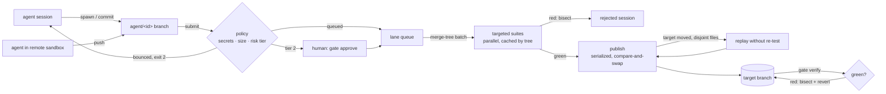

# gate

[](https://github.com/juw12/gate/actions/workflows/ci.yml)
[](https://github.com/juw12/gate/releases)
[](LICENSE)

A merge gate for AI-agent-generated code. Many parallel agent sessions go in; a small number of
tested, risk-tiered, provenance-tagged commits come out. Humans review only what policy says
needs a human.

| Bottleneck | What gate does |
|---|---|
| Merge contention | Server-style merges with `git merge-tree` (no checkout), batched, published with compare-and-swap (`update-ref old new` locally, `--force-with-lease` to a remote). |
| Throughput | **Lanes**: path-partitioned queues that merge and test in parallel (`queue --parallel N`). Only a short publish step is serialized. If the target moved while a lane was testing but none of the moved files overlap the lane's files, the lane's commits are replayed onto the new tip (`Commuted-From:` trailer) instead of re-tested. |
| CI cost / slow suites | Targeted suites (`[[tests]]` with `paths`) run only when relevant files change. They run in parallel, each in its own checkout, and pass results are cached by tree, so bisection, retries and `verify` never re-run a suite on a tree that already passed. Batches are bisected on failure. |
| Semantic conflicts | `gate verify` tests the target. If it's red, it bisects the commits since the last green point, finds the agent commit that broke it, tests a revert, and publishes the revert (session marked `reverted`). |
| Review load | Risk tiers from path policy. Tier 2 (auth, infra, CI, migrations, the policy file) waits for `approve --by NAME`. Changes over `max_changed_lines` bounce back to the agent. |
| Secrets | Submit-time scan of added lines blocks the merge (`reason: secret`) without echoing the value. Traces and archived patches are redacted (known token formats, URL credentials, `key = value`, high-entropy tokens). An optional external scanner (e.g. gitleaks) fails closed: a trace it still flags is not stored. |
| Integrity | Policy is read from the target branch; the exact submitted/approved head SHA is what merges. |
| Provenance | `Agent-Session`, `Agent-Model`, `Agent-Tool`, `Spec`, `Prompt-SHA256`, `Trace-SHA256`, `Risk-Tier`, `Approved-By`, `Agent-Lane`, `Agent-Base`, `Agent-Head` trailers; author = agent, committer = `gate`. |
| Retention / ref clutter | Merged sessions delete their branch at once; rejected ones keep it for a grace period, then become a gzipped, redacted diff outside Git refs. Traces expire by outcome. |
| Checkout cost / remote agents | Shared object store, per-agent worktree with optional sparse cone, or `spawn --no-worktree` for agents running in remote sandboxes that push `agent/<id>`. |

Standard library only. Python ≥ 3.11, Git ≥ 2.40.

## How it works



State lives in `.git/gate/` (session JSON, counters, gzipped traces and archived diffs) and never in Git refs,
so agent attempts don't bloat clones. Every write is a temp file + atomic rename; cross-process exclusion uses
lock files that record `pid host`.

## Install

```bash
pip install git+https://github.com/juw12/gate      # puts `gate` on PATH; or copy gate.py, it has no dependencies
gate --version
```

## Quick start

```bash
cd your-repo
gate init                        # writes gate.toml (lanes, suites, secrets, retention)
git add gate.toml && git commit -m "gate policy"
git switch --detach                   # the gate must not have the target branch checked out
gate doctor                      # add --write-test when `remote` is set

# per agent session
WT=$(gate spawn fix-1234 --sparse services/api)   # or: --no-worktree for remote sandboxes
#   ... agent works and commits ...
gate trace  fix-1234 ./session.jsonl              # optional; redacted, gzipped
gate submit fix-1234 --model <exact-model-id> --tool claude-code/2.x --spec ISSUE-1234

# gate (cron/systemd/CI loop)
gate queue --drain --parallel 8
gate verify                      # every N minutes: bisect + auto-revert a red target
gate status                      # needs_approval / reverted / too_large / rejected first
gate approve fix-1234 --by alice
gate stats
gate gc                          # daily
```

## For agents and automation

Put `--json` before the subcommand to get exactly one JSON document on stdout and nothing else:

```console
$ gate --json submit fix-1234 --model claude-x
{"command": "submit", "exit_code": 0, "result": {"session": "fix-1234", "status": "queued", "tier": 1,
 "lane": "api", "sized_lines": 42, "files": ["services/api/x.py"], "reason": null, "findings": [], ...},
 "events": []}

$ gate --json queue --drain
{"command": "queue", "exit_code": 0, "result": {"lanes": ["api"], "merged": [{"session": "fix-1234",
 "commit": "9f1c...", "lane": "api"}], "rejected": [], "recovered": [], "still_queued": 0}, "events": [...]}

$ gate --json show nope
{"command": "show", "exit_code": 1, "error": "unknown session 'nope'", "events": []}
```

An agent loop needs three calls: `spawn` (read `result.worktree`), `submit` (read `result.status`; on exit 2
read `result.reason` / `result.findings`, fix and resubmit), then poll `gate --json show <id>` until
`result.session.status` is `merged`, `rejected` (read `detail`) or `reverted`. `submit` is idempotent: retrying
an unchanged queued session returns the same answer instead of an error.

| Exit code | Meaning |
|---|---|
| `0` | ok |
| `1` | error: usage, git or environment problem; a lock held by a live process; `doctor` found a failing check |
| `2` | `submit` bounced by policy: `too_large`, or secrets on added lines (`rejected`, reason `secret`) |
| `3` | `verify`: target is red and needs a human (no green baseline, revert conflicts, revert still red, or `--no-revert`) |
| `4` | `verify`: target moved while publishing the revert; run `verify` again |

## Crash safety

Any gate process can be killed at any point without losing or duplicating work:

| Killed while... | Next run |
|---|---|
| testing a batch | Nothing was published. The lane lock names a dead pid, so the next `queue` takes it over at once and re-lands the batch (passing suites are cached by tree, so they aren't re-run). |
| publishing | The ref update is a single compare-and-swap (`update-ref old new`, or `push --force-with-lease`): it either happened or it didn't. |
| after publishing, before recording `merged` | `queue` (and `gc`) first reconciles: every gate commit carries an `Agent-Head` trailer, so sessions whose head is already on the target are marked `merged` (`recovered: true`) instead of being landed twice. |
| after recording `merged`, before deleting the branch | `gc` removes leftover branches and worktrees of merged/abandoned sessions. |

Locks from a dead process on the same host are taken over immediately; a lock from another host (shared
filesystem) is only broken after it is older than `max(1 h, 4 × test_timeout_s)`. These paths are covered by tests
that simulate a kill after publish, leftover branches, and dead/live/remote lock owners.

## Measured

Unit/e2e: `python -m unittest -v test_gate`, 32 tests on real repos (crash recovery, contended locks, JSON interface,
remote races, verify/revert, secrets). CI also enforces `ruff`, `mypy` and ≥ 85 % line coverage of `gate.py`.

Throughput, from `python bench.py --sessions 160 --lanes 8 --test-seconds 2 --batch 8` on one Windows laptop
(Git 2.55, Python 3.13), with a 2 s sleep standing in for CI:

| `--parallel` | wall | merges/day (extrapolated) | commuted publishes | publish-lock hold | ceiling of the serialized step |
|---|---|---|---|---|---|
| 1 | 109.5 s | 126 k | 0 / 24 | 87 ms | — |
| 8 | 45.9 s | 301 k | 22 / 24 | 1.4 s per 6.7 merges | ≈ 408 k/day |

The serialized publish step stops being the limit at about 400k merges/day on this hardware.
Above that, throughput is set by CI capacity: about \(\text{lanes} \times \text{batch} / \text{test time}\).
With 10-minute suites and batches of 8, 30k merges/day needs about 26 lanes' worth of CI workers.

With `remote` set, each publish also does a fetch and a `--force-with-lease` push. Against
github.com through a corporate HTTP proxy, that held the publish lock about 9 s per publish,
a ceiling of \(86400 / 9 \times 8 \approx 77\text{k}\) merges/day at batch 8. That is still above 30k; raise
`max_batch` or run the gate close to the remote if you need more.

## Publishing to GitHub

Set `remote = 'origin'`. The gate fetches, merges and tests locally, then pushes with
`--force-with-lease`. Give the gate's bot account or deploy key a ruleset bypass on the target
branch. `gate doctor --write-test` proves reachability and write access by pushing and deleting a scratch ref.
It cannot prove the bypass on the protected branch itself; only a real publish does.
Agents never open PRs, so `refs/pull/*` doesn't grow.

Verified against github.com (this repo, on a throwaway branch): `doctor --write-test`
passed; a session published and GitHub's branch head matched the gate's merged commit; with a
concurrent human push landing mid-test, the gate kept the human commit and replayed its own
commit on top (`Commuted-From:`) without re-testing.

## What is still out of scope

- **Semantic conflicts are caught after the fact, not prevented.** Batches are tested together, and
  `verify` reverts a regression that a commuted publish (or a human) introduced. A bug no test detects is
  invisible to any merge gate.
- **Redaction is best-effort.** Patterns plus entropy catch common formats; plug in gitleaks/trufflehog via
  `secret_scan_command` for fail-closed coverage, and still treat traces as sensitive.
- **One host holds the state.** Lanes run in parallel, and several gate processes on the same host can share a
  repo (file locks), but state lives in `.git/gate`. Running gates on several hosts needs a shared store.
  A Scion-class system would replace the file locks with a database.
- **Platforms:** CI (`.github/workflows/ci.yml`) runs tests, demo and benchmark on Linux, macOS and
  Windows × Python 3.11/3.13.

See [CHANGELOG.md](CHANGELOG.md) for releases and [CONTRIBUTING.md](CONTRIBUTING.md) to work on gate.
MIT licensed.
